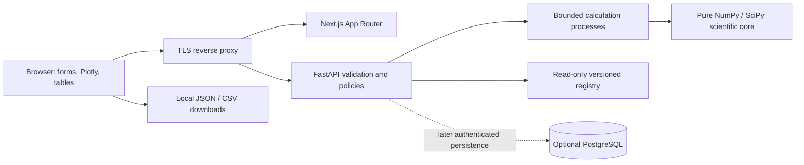

# Architecture

## Chosen baseline

Monorepo with Next.js frontend and FastAPI service. A same-origin reverse proxy routes `/api/v1/*` to Python; Next.js owns the remaining routes. No mandatory database, account or background queue service. Small bounded calculations run synchronously through a bounded process executor. The request is synchronous, the computation boundary is killable, and proxy/app deadlines are aligned.

## Boundaries

- `domain/units`: Pint allowlisted unit parsing and conversion; absolute vs delta temperatures.
- `domain/kinetics`, `flux`, `regimes`, `sweeps`, `spatial`, `metrics`: pure functions accepting SI numerical types, no HTTP/database state. SciPy may be used for independent reference integration and later scientifically reviewed extensions; the baseline algebra does not require a nonlinear solver.
- `services/simulation`: schema-to-domain conversion, semantic validation, constraint evaluation, snapshot and warning assembly.
- `api`: Pydantic request/response models, middleware, resource caps and structured errors.
- `registry`: immutable source and parameter snapshots with explicit unresolved fields.
- frontend: generated API types, form draft state, last successful snapshot, chart adapters, local project import/export and comparison. No authoritative physics duplicated in frontend.

## Request lifecycle

1. Proxy enforces size/timeout/rate limits and request ID.
2. FastAPI performs strict Pydantic validation and application semantics; normalize units and evaluate material/constraint applicability.
3. Hash canonical normalized computational inputs plus model/registry version. Preserve original user input separately.
4. Submit to bounded executor; reject when saturated; kill timed-out computation and replace worker safely. Run finite checks.
5. Assemble deterministic scientific data plus nondeterministic run metadata; serialize through the strict response schema.
6. Client binds response to the request snapshot id; late responses cannot overwrite a newer result. User edits produce stale status.

## Data and state

Baseline backend does not persist request contents. Client can opt into local browser project storage, with disclosure and clear controls; no credentials/tokens in browser storage. An exported project is the portable source of truth. Imported result data is untrusted and must not be treated as independently recomputed or validated.

## Optional persistence release

Only after product need: managed OIDC authentication and PostgreSQL with migrations. Tables: users (provider subject mapping), projects (owner), scenario_versions (immutable input JSON plus schema/model/registry versions), simulation_runs (scenario id, immutable result/hash/status), registry_versions, audit_events. Every query is owner-scoped. Unique `(project_id, revision)`; foreign keys; index `(owner_id, updated_at)` and `(scenario_version_id, created_at)`. Use JSONB for versioned scientific payloads plus relational identity/access columns. No multi-tenant deployment without cross-user authorization tests, export/delete workflow, backup/restore evidence and retention policy. Auth and PostgreSQL are not prerequisites for local baseline.

## Decisions and scaling

CPU computation must not block an async event loop. A process pool count is bounded against actual memory/CPU; start conservatively and measure. Public anonymous deployment requires quotas even if math is simple. If workloads outgrow sync caps, introduce a persistent job queue, idempotency and cancellation as a separate API/model release; do not turn FastAPI BackgroundTasks into an undocumented durable scheduler. Do not cache private requests in shared CDN caches. Only cache immutable public registry data.

## Version policy

API `/v1` and schema `1.0.0` are distinct from `cvd-resistance-v1`, `prescribed-radial-v1` and registry version `0.1.0-unresolved`. Breaking shape changes bump major schema/API. Any mathematical behavior change gets a new model identifier. Store exact dependency lock and application commit in runtime capabilities and run metadata.
